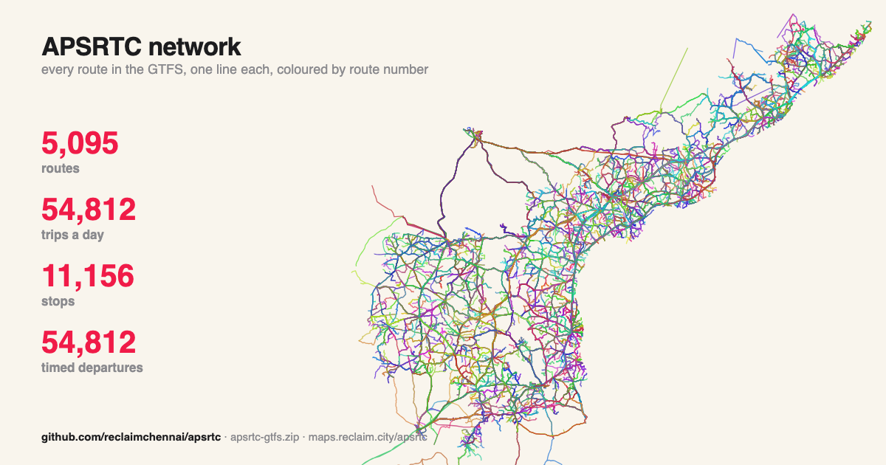
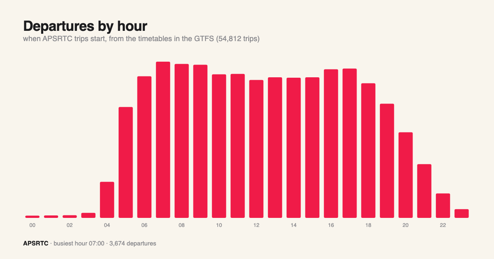
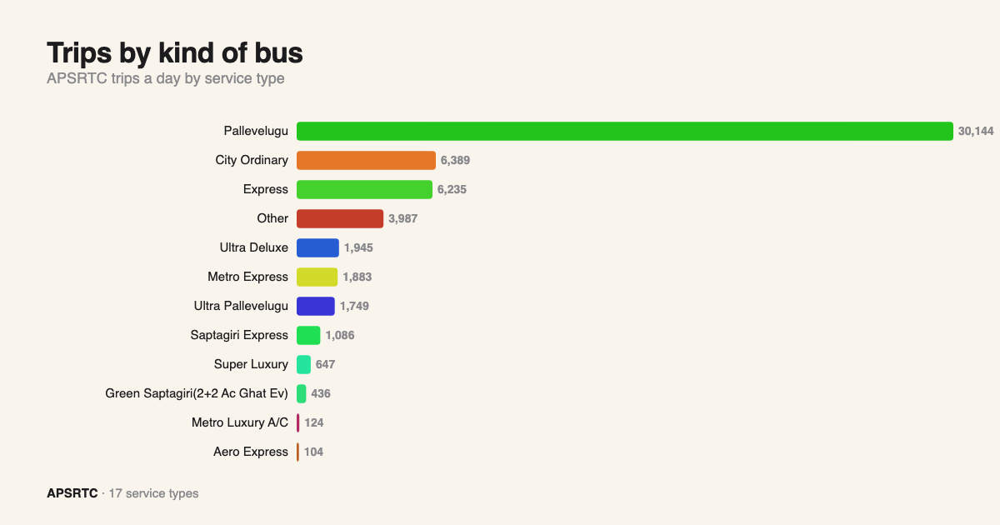
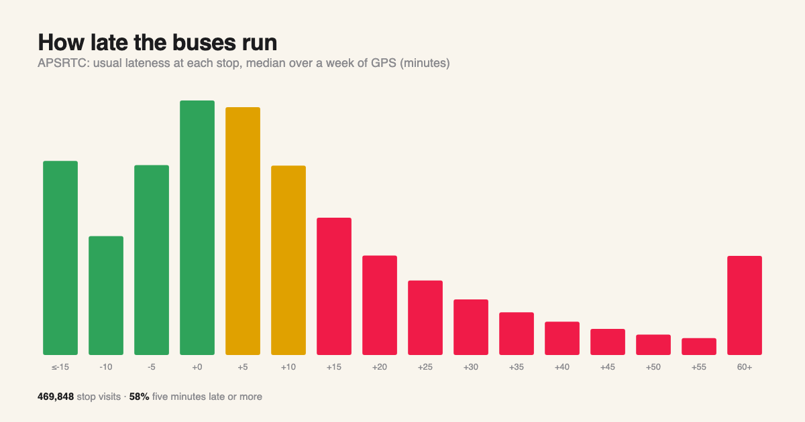
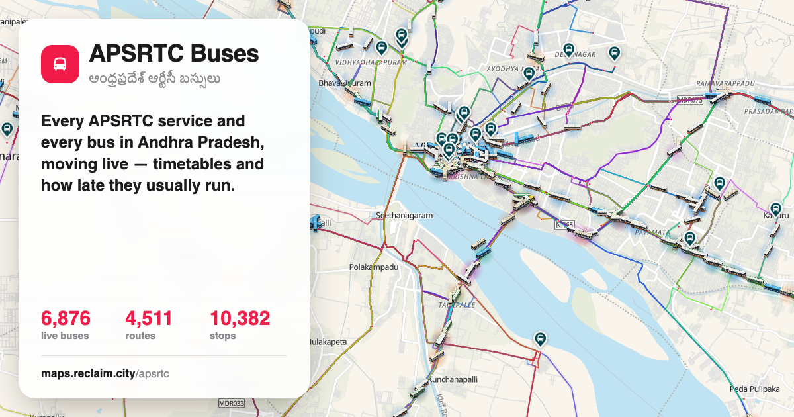
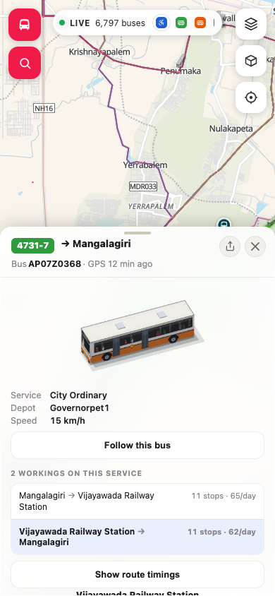
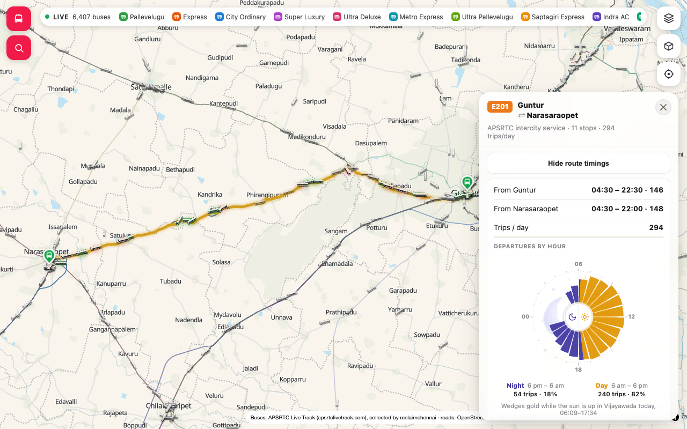
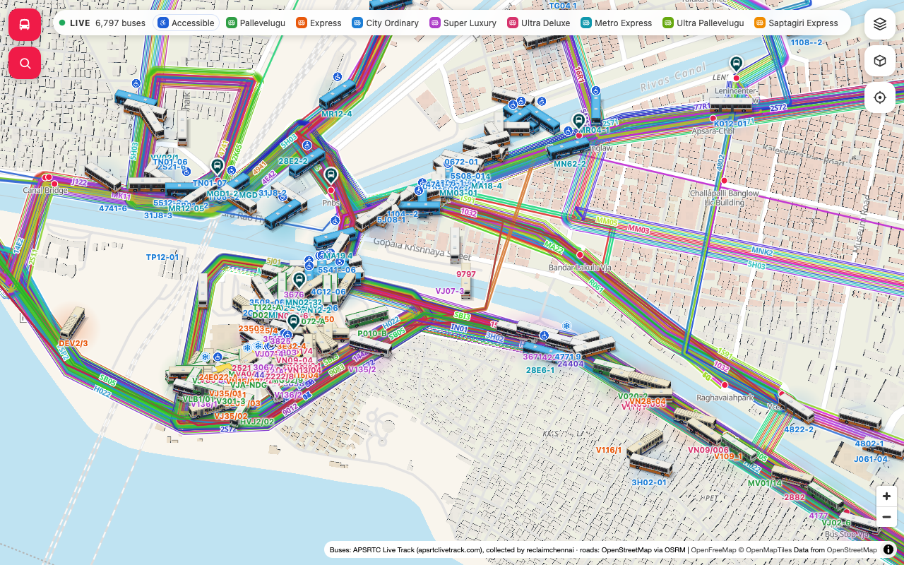

# APSRTC — open bus data for Andhra Pradesh

   

Every APSRTC (Andhra Pradesh State Road Transport Corporation) service we have seen, as one
GTFS feed, with how late each one usually runs. Collected by **reclaim.city** for the live map at
**[maps.reclaim.city/apsrtc](https://maps.reclaim.city/apsrtc/)**. APSRTC publishes no GTFS of its own.



## What's in it

| File | What | Size |
|---|---|---|
| [`data/apsrtc-gtfs.zip`](data/apsrtc-gtfs.zip) | **The GTFS feed** — agency, routes, trips, stops, stop_times, shapes, calendar, feed_info | 5,095 routes · 54,812 trips · 11,156 stops · 615,001 stop times · 11,631 shapes |
| `data/gtfs/` | the small GTFS files unzipped, to browse | |
| [`data/stop_delays.csv.gz`](data/stop_delays.csv.gz) | per trip and stop: the **median lateness** over a week of the bus's own GPS (minutes) | 469,848 rows |
| [`data/punctuality/`](data/punctuality/) | per service day (`YYYY-MM-DD.csv.gz`) and stop: scheduled time, GPS arrival and departure, delay, dwell, skipped | 4,202,776 rows, 8 days |
| [`data/service_days.csv.gz`](data/service_days.csv.gz) | per service and day: the bus that ran it, depot, service type, start/end delay, GPS fixes | 407,547 rows (2026-11-03 to 2026-11-11) |
| [`data/stats/`](data/stats/) | `punctuality_by_depot.csv`, `punctuality_by_type.csv` (median and 80th-percentile delay at the last stop, % on time −2…+5 min), `coverage.csv` (services, buses and depots per day), `fleet_by_depot.csv` (buses and services by depot and type) | |
| `data/web/` | the live map's own network files (stops, services with timetables and delays, road segments) | |
| `data/stats.json` | the numbers on this page | |
| `tools/` | how this repo is built from the collected data (`build_apsrtc.py`, `charts.py`, `readme.py`); the collectors are not published | |

### How it is built

- **Stops** are APSRTC's own place ids (`placeId`), the same ids the APSRTC Live Track app uses.
- **Trips** are APSRTC services (`<duty>_<trip>_<DEPOT>`, a service that repeats every day), each with its
  stop list and timetable as the app publishes them. `trip_short_name` is APSRTC's service number.
- **Routes** are corridors, as on the map: every service between the same two termini, city services
  (City Ordinary, Metro Express, Metro Luxury) kept apart from intercity ones. `route_id` is the map's
  route address (`maps.reclaim.city/apsrtc/?route=<route_id>`); `route_short_name` is the most common
  route code on the corridor. APSRTC has no public route numbers.
- **Shapes** follow the road between consecutive stops: OSRM on OpenStreetMap, or where OSRM has no road,
  the path buses actually drove (from their GPS).
- **De-duplicated**: one trip per service; the Neo2308 community GTFS (Aug 2026) is merged only where it
  has a service we do not (462 trips, route ids `neo-…`).
- No driver data is in this repository, and none was ever collected into it.

## Use it

```bash
curl -LO https://github.com/reclaimchennai/apsrtc/raw/main/data/apsrtc-gtfs.zip
```

Load it into OpenTripPlanner, `gtfs-kit` / `partridge` (Python), `tidytransit` (R), or any GTFS tool.

## See it live

[maps.reclaim.city/apsrtc](https://maps.reclaim.city/apsrtc/) — every route and every live APSRTC bus, the next bus
at every stop, timetables and how late they usually run.

## Statistics















## Licence

Data: [ODbL 1.0](LICENSE). Please credit **reclaim.city** and the sources above.

## Sources

| What | Source |
|---|---|
| services, stops, timetables, GPS | the public **APSRTC Live Track** app (apsrtclivetrack.com), collected by reclaim.city |
| roads | OpenStreetMap, routed with OSRM |
| extra services | [Neo2308's APSRTC GTFS](https://github.com/Neo2308) (Aug 2026) |

### Limitations

- Unofficial: built from what the public app shows; APSRTC may change or withdraw services at any time.
- One calendar (`daily`): the app lists today's services; services that do not run every day are not told apart yet.
- Times are the timetable. How late a service actually runs is in `stop_delays.csv.gz` and `punctuality.csv.gz`.
